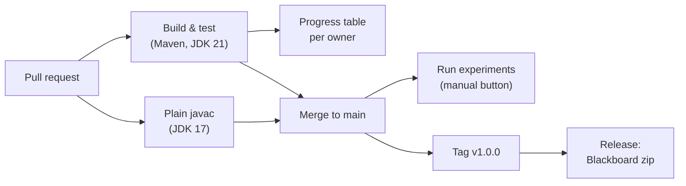

# CI/CD design

## What runs today

| Workflow | Trigger | What it checks or produces |
|---|---|---|
| `ci.yml` → Build & test | every PR, push to `main` | Compiles at `--release 17`, runs JUnit, writes the per-owner progress table |
| `ci.yml` → Plain javac | every PR, push to `main` | Builds with plain `javac` on JDK 17 and runs `Main` from the repo root, like the instructor might |
| `experiments.yml` | manual | Runs Experiments A and B and puts both tables in the job summary |
| `release.yml` | tag `v*` or manual | Runs the tests, then zips `src/`, `campus_graph.txt`, `README.md` and the jar |
| Dependabot | weekly | PRs that bump action and plugin versions |

## Why these and not more

The program is a CLI that prints to the console, so there is no server to deploy.
The useful automation is:

1. Never merging something that breaks another person's part.
2. Keeping the exact output format the assignment shows.
3. Building the submission the same way every time.

## Optional extras

- **GitHub Pages.** After Part II, a small static page could animate the MST trace from a JSON export of `PrimMST.getTrace()` and chart the experiment CSVs. A Pages workflow would redeploy it on every merge to `main`. It's free for public repos.
- **Self-hosted runner** on your own machine, for steadier experiment timings than shared runners. Only do this while the repo is **private**. On a public repo, anyone can open a pull request that runs code on your machine.
